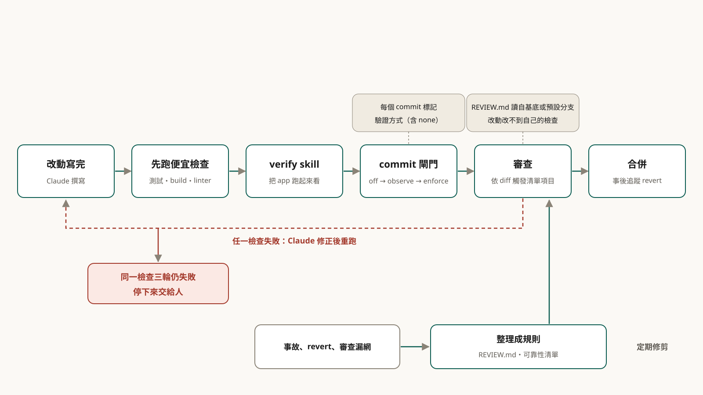

# 讓 agent 拿證據交差：Claude Code 團隊的驗證做法

*封面：很多 agent 平行工作，每份產出都要過一道檢查，人負責檢查證據。AI 製作的示意圖。*

> 本導讀的分析、撰稿、翻譯、查證、審稿與插圖由 AI 模型完成，不是人類分析，也沒有經過人工逐句校稿。模型分工見文末〈製作說明〉；全文繁中譯本見 [translation-zh.html](translation-zh.html)。

## 三十秒版

- Addy Osmani 在 [claude.dev 部落格](https://claude.dev/blog/how-the-claude-code-team-thinks-about-verification/)（2026-11-16）寫 Claude Code 團隊怎麼讓 agent 用證據驗證自己的工作。前提是：同時能放手讓幾個 Claude 跑，取決於驗證迴圈，不取決於你有多少時間逐行看 diff。
- 前半是給讀者的測試選型：若只能挑一種，挑端對端（E2E）測試；再補性質測試（property test），它的邊界輸入不是寫程式那個 agent 帶著同樣偏誤想出來的；以及差異測試（differential test），拿舊系統當判準。
- 後半是團隊自己的規矩，重點放在**檢查本身也要被管**：受檢的改動改不到檢查、新閘門先觀察再強制、用真實事故評分審查者、漏網的 bug 變成規則，規則也要定期修剪。
- REVIEW.md 從基底或預設分支讀取、Important／Nit／Pre-existing 三種標籤、用 hook 在 Claude 停下前跑測試，這幾點有官方文件佐證；39 項可靠性清單、三輪失敗交人、commit 閘門的三種模式，目前只有這篇文章自述。

## 這篇文章在回答什麼

文章開頭就交代規模：Claude Code 團隊「絕大多數」的程式碼，約九成由 Claude 撰寫並由 Claude 審查。這是 Anthropic 在自家部落格描述自家團隊的做法，數字與流程都是團隊自述。原文連到的 [10 月 code review 文章](https://claude.dev/blog/solving-code-review-at-anthropic/)寫的是「Claude 撰寫約 90% 的 Claude Code 程式碼」；審查部分只說每個 PR 在人看之前都先經 Claude 審過，沒有給比例。

在這個規模下，Osmani 認為，**沒有驗證迴圈，你一次只能跑一兩個 Claude**，因為每樣東西都得自己檢查；有了驗證迴圈，可以平行跑幾十、上百個。

他用一個數字支撐「讓 agent 有辦法驗證自己」的價值：在結構化檔案生成的內部測試裡，讓獨立評分器依評分準則（rubric）檢查 Claude 的產出，任務成功率比標準提示迴圈最多高 10 個百分點，最難的題目進步最多。這個數字出自 [Managed Agents 的上線公告](https://claude.com/resources/articles/claude-managed-agents)（2026-04-08）的內部測試，主詞是 Managed Agents、描述的是 Claude 依成功條件自我評估，並不是專門針對程式碼驗證的數字。

另一個前提是成本翻轉。測試、基準測試、規格、真實的端對端執行，以前寫起來貴，現在請 agent 產生很便宜；產生之後它們就是普通軟體，可以一直跑，不太花 token。驗證結果還能回頭改進 agent：如果 agent 一再在「檢查日誌有沒有使用者資料」的測試上失敗，就加一個 hook 或在 CLAUDE.md 寫更明確的規則，原文說這樣大致能讓問題不再發生，「大致」是原作者自己加的保留。

## 先選對測試：E2E、性質、差異

選哪種測試之前，Osmani 先講兩個會讓任何測試失效的毛病。測試不穩定（flaky），agent 學會遇到失敗就「再跑一次」，程式沒修；測試太慢，agent 每批跑的測試就變少，問題更難定位。比較重的測試，最好放在 commit 之前跑。

接著是他認為最值得投資的三種：

| 測試類型 | 判準從哪來 | 擅長抓什麼 |
|---|---|---|
| 端對端（E2E） | 真實使用者流程：註冊、加入購物車、結帳、看到確認頁 | 整個功能能不能用；失敗時指出壞在哪一步 |
| 性質測試 | 一句你認為不會錯的陳述，交給函式庫產生上千筆輸入去推翻 | 人容易漏掉的邊界案例 |
| 差異測試 | 舊系統就是判準，新舊兩套吃同樣輸入比結果 | 大規模搬遷時功能應該不變的地方 |

### E2E：要嘛整個功能能用，要嘛不能

Osmani 說 E2E 有效，是因為它「很難被騙過」：完成條件明確，壞了能具體說出哪裡壞。單元測試比較快、比較穩，但可能全部通過、功能照樣壞掉，原因是 agent 和測試都沒有理解完整的任務。原文用一張配圖對照兩種失敗訊息，下面依其說明重畫：

<!-- FIG:fig-a-test-failure -->

要讓 agent 跑 E2E，就要給它「手和眼」：用 skill 啟動、操作、檢查真正在跑的系統，工具可以是 [Chrome DevTools Protocol](https://chromedevtools.github.io/devtools-protocol/)、模擬器或 API harness。產品的功能地圖（feature map）通常從使用者角度列出路徑、快速鍵、選擇器與預期結果，可以同時當 agent 的指引和評分準則。

### 性質測試：邊界案例不能由同一個腦袋來想

很多測試寫的是「你想得到會出錯的地方」，而 agent 常常栽在人也沒想到的邊界。性質測試反過來：先寫下一句不該失敗的陳述，再用 [fast-check](https://fast-check.dev/)（JS／TS）、[Hypothesis](https://hypothesis.readthedocs.io/en/latest/)（Python）、[proptest](https://proptest-rs.github.io/proptest/)（Rust）這類函式庫產生上千筆輸入試著推翻它。

Osmani 說幾乎每個專案都有不少性質可測，他舉了四種：編碼後再解碼要得到原值（解析、序列化也適用）；帳戶餘額永遠不能是負數這類不變量；遷移、正規化、重試做兩次和做一次效果相同；最佳化過的程式和樸素但正確的版本結果相同。他看重的是輸入的來源：**邊界案例由函式庫產生，不經過寫程式那個 agent 的同一套偏誤**。規格早已和正式環境行為脫節的改寫專案，也特別適合用它。

### 差異測試：舊系統當答案卷

差異測試適合功能預期不變的大規模搬遷。**新舊系統吃同一批輸入，結果不同就是 bug 或破壞性變更。**關鍵在輸入要隨機產生或取自正式環境流量，空白這類無關差異先正規化，刻意改變的行為記進核准清單。文中連到的 Anthropic [程式遷移文章](https://claude.com/resources/articles/ai-code-migration)有一個相近的實例：遷移收尾時把每個指令的輸出和原本 Python 版逐一比對。

## 驗證就是把改動跑起來

文章後半轉向 Claude Code 團隊自己。第一條規矩是**把 app 端對端跑起來，比測試更重要。**你不會沒在模擬器上試過就發布 iOS 改動，Claude 也一樣。

做法是讓 Claude 像人或 QA 工程師那樣操作整個 app：網頁改動用 Claude 的 Chrome 擴充功能，行動裝置用 iOS 或 Android 的 MCP，桌面程式用 computer use，後端就在本機把服務跑起來。怎麼啟動模擬器、怎麼跑 app，寫成一個叫 `verify` 的 skill，放在 repo 的 `.claude/skills/`，盡量靠近相關程式碼，需要幾個就放幾個。原文說 Claude 知道 commit 前要用 verify skill，並說 Anthropic「幾乎所有改動」都是這樣測的。

這句「commit 前會用」在 [Claude Code 的 skills 文件](https://code.claude.com/docs/en/skills)有對應：session 開始時若已有名為 verify 或 simplify 的 skill，Claude Code 的 commit 指示會要求在每次 commit 前執行，純文件或純測試的改動除外。要注意兩個條件：需要 v2.1.286 以上；照原文建議把 skill 放在靠近程式碼的子資料夾時，文件沒說這條 commit 前的指示會不會觸發。

Osmani 要讀者把 verify skill 當成冒煙測試（smoke test）的 harness 來經營：請 Claude 反覆改它、對它做壓力測試，讓它又快又穩。給 Claude 一個能端對端冒煙測試的方法，它會像人一樣更快迭代、抓到真正的錯。

## 團隊怎麼分工檢查

接下來幾條規矩，串起來看是一條改動從寫完到合併的路線。下圖是本導讀依原文段落歸納的示意，原文沒有這張圖：

*圖：一個改動會經過的檢查與兩條回饋路線。本導讀依原文歸納，順序為示意。*

### 失敗是分派人力的訊號

沒有人能讀完每個改動，所以團隊用失敗作為決定哪裡需要人的方式之一。Claude 跑檢查、自己修失敗的項目；**同一項檢查三輪後還是失敗，Claude 停手，找人來看。**「三輪」是這個團隊的設定，原文沒說明為什麼是三。

### 誰擁有程式碼，誰寫檢查

檢查由 code owner 自己寫，一直調到它會標出 owner 本人會標的東西。檢查把審查者拉進來時要附上理由，讓對方不必從 diff 自己推敲。

### 可靠性清單依 diff 觸發

團隊維護一份 39 項的可靠性清單。每一項有三樣東西：能從 diff 看出來的觸發條件、一個檢查、以及當初催生它的事故或 PR。原文舉的例子是「`--resume` 載入舊的對話紀錄」：session 儲存格式或訊息類型一改，就要問新欄位能不能安全載入，因為舊的對話紀錄沒有這個欄位。Claude 讀 diff，只檢查觸發條件符合的項目，通常是 3 到 10 項，這樣就沒有人需要記住過去每一次服務中斷。

39 這個數字只有原文提到。對讀者比較有用的是它的格式：**觸發條件可以從 diff 讀出、附檢查方式、附來源事故**，這種寫法從第一次事故就能開始累積。

### 一個審查者，多輪接力

團隊不靠多疊審查者來提升審查品質。原文說，在主要審查者上再加一個更貴的第二審查者，**常常不如把主要那個調好**；調的方法是寫一份 [REVIEW.md](https://code.claude.com/docs/en/code-review-customize)，告訴審查者這段程式碼要注意什麼。審查與驗證的各輪也要接力：每一輪都帶著前幾輪的結果和過去的失敗，不從頭全部重查，比較省，也找得比較多。

## 檢查本身也要守規矩

### 改動碰不到評它的檢查

> 重點：如果一個改動能修改評它的那個檢查，那個檢查就壞了。

Code Review 讀 REVIEW.md 時，讀的是 PR 的基底分支或預設分支上的版本，從不讀 PR 自己帶進來的修改，[官方文件](https://code.claude.com/docs/en/code-review-customize)寫得一樣，並提醒要改審查行為得先把 REVIEW.md 的修改合併進去。團隊也確保擋改動的規則放在改動改不到的分支上。

審查也只對特定 commit 有效。審查進行時有人又 push，結果就沒用了，過時 commit 的「通過」不代表任何事。

另一條是先跑便宜的檢查。agent 沒在本機測過就 push，花掉的是大家共用的審查與 CI 時間。團隊的 Claude 在開 PR 前會先跑測試、build 和 linter。原文建議用 [hook](https://code.claude.com/docs/en/hooks) 在 Claude 結束時跑測試，或用 [/goal](https://code.claude.com/docs/en/goal) 把「測試全過」設成目標。兩者性質不同：Stop hook 可以跑腳本，未通過可以要求 Claude 繼續工作、不讓它停下；/goal 的評估模型只讀對話內容、不自己跑指令，官方文件也說明，要確定性檢查可以用 Stop hook 跑腳本。

### 新閘門先開觀察模式

團隊在自家 repo 的每個 commit 上標記它是怎麼驗證的，選項包括「none」，方便查出哪些 commit 沒驗證。他們另做了一個 commit 閘門：session 裡沒跑過 /code-review 或 /verify，就擋下 commit。閘門有關閉、觀察、強制三種模式。觀察模式只記錄「本來會擋哪些」，用來檢視誤報、確認不會干擾到人；強制模式才真的擋。

強制模式下，任何 commit 都可以在訊息裡寫明為什麼沒驗證（原文沒說寫了理由就會放行）；另外，同一個 session 已被擋兩次，第三次就放行，原文的理由是「Claude Code 並不完美」，不想讓 Claude 卡死。和每個 commit 都帶驗證標記（含 none）合起來看，可以讀成**允許例外，但例外查得到**；這是本導讀的讀法，原文沒有直接把兩件事連起來。原文沒有提供 none 或放行的比例，這套閘門也沒有公開實作。Code Review 產品本身依[官方文件](https://code.claude.com/docs/en/code-review-pull-requests)不會核准或擋下 PR，這裡的「擋」是團隊在自家 repo 另外設的規矩。

## 審查審查者：用真正重要的 bug 評分

團隊會定期審查自己的審查者。日常指標有三個：合併後被 revert 的改動數、維護者在合併前退回的改動數，以及一組規模相當、一直沒出事的改動當對照。

更正式的做法是評測。原文說 Code Review 團隊用過去的事故與 revert 建立評測集：每個例子把 repo 還原到審查當時的狀態，附一句話的標準答案說明 bug 是什麼，只有正確描述那個 bug 的發現才得分；用已合併且穩定的改動當對照，防止審查者過度標記；調校用的資料和評估用的固定測試集分開。其中多數細節只見於原文，先前的 code review 文章只寫到用事故與 revert 建例、在已知乾淨的 PR 上量誤報。

他們還把召回率拆成三段分別量：原始發現、驗證之後、最終審查。**拆開才看得出系統有沒有把已經找到的 bug 在後段弄丟**；只看一個端對端總分，看不出這種流失。

除了對不對，還要看這個修改有多必要。好的審查者會抓到大部分技術上成立的問題，但人在意的是它屬於必修、該修，還是細節小問題。Code Review 把發現標成 [Important、Nit、Pre-existing](https://code.claude.com/docs/en/code-review-pull-requests) 三級，Pre-existing 的意思是 bug 本來就在，不該算到這次作者頭上。最後，團隊把召回率往上調，一直調到再往上只剩迎合評測、抓不到真 bug 為止。

## 漏網變規則，規則也要修剪

Claude Code repo 有兩條把漏網變規則的路。第一條從人工審查留言和 PR 的 revert 裡找模式：同一個模式要出現在至少兩個 PR、而且能從 diff 看出來，才算候選規則；接著由三個 agent 試著反駁它，最後由人在 PR 裡審核同意。第二條是拿一個和已知事故相關的 PR，重播三個 bug 偵測器：至少兩個抓到，就算這個 bug 是可偵測的；如果它在一個小 diff 上被漏掉，就是值得寫進 REVIEW.md 的缺口。這兩條流程目前只見於原文。

不穩定的測試用同樣標準處理。Claude 不能跳過它、不能加 sleep、不能重試到過；**找不到根因，就刪掉這個測試並寫下原因。**

最後，規則也要清。測試套件、驗證步驟、各種 .md 檔，放著不管只會越長越多，所以團隊定期整理。

## 讀的時候值得留意的地方

這篇文章寫得緊湊，有幾處讀者容易一眼帶過：

- **E2E 難騙，但通常比單元測試慢、也比較容易不穩。**原文在 E2E 段也承認這點（單元測試「比較快、比較不 flaky」），但沒有回頭說明 E2E 要怎麼避開前面警告的 flaky 問題，也就是 agent 學會「再跑一次」。
- **「檢查不能被改動修改」與「找不到根因就刪 flaky 測試」之間有張力。**後者等於讓改動動到檢查，原文用「寫下原因」來約束，但沒說誰審這個原因。
- **數字都是 Anthropic 團隊自述的設定或內部測試。**約九成、最多 10 個百分點、39 項、通常 3 到 10 項、三輪、兩次，各有範圍，不宜當通則套用。

下表整理文中主要說法目前能找到的佐證：

| 說法 | 原文怎麼說 | 狀態 |
|---|---|---|
| Code Review 從基底或預設分支讀 REVIEW.md | 從不讀 PR 自己的修改 | 官方文件佐證 |
| Important、Nit、Pre-existing 三種標籤 | 人在意必修、該修或小問題；產品用這三種標籤，Pre-existing 表示 bug 本來就在 | 官方文件佐證 |
| hook 在 Claude 結束時跑測試 | 可用 hook 或 /goal 強制 | 官方文件佐證（/goal 不自己跑指令） |
| verify skill 在 commit 前執行 | Claude 知道 commit 前要用 | 官方文件佐證（有版本與位置條件） |
| 約九成程式碼由 Claude 撰寫並審查 | 撰寫與審查 | 部分佐證（連結文章講撰寫約 90%、每個 PR 先經 Claude 審查，審查沒有比例） |
| 獨立評分器使任務成功率最多高 10 個百分點 | 結構化檔案生成的內部測試 | 出自 Managed Agents 公告，不是程式碼驗證的數字 |
| Code Review 團隊的評測設計 | 已在 code review 文章描述 | 部分佐證（建例方式有，多數細節只見原文） |
| 39 項可靠性清單、通常觸發 3 到 10 項 | 每項有觸發條件、檢查、來源事故 | 僅原文自述 |
| 同一檢查三輪失敗交人 | Claude 停手找人 | 僅原文自述 |
| commit 閘門三種模式、被擋兩次放行 | 內部 commit 閘門 | 僅原文自述 |
| 漏網變規則的兩條流程 | 兩個 PR、三個 agent、三個偵測器 | 僅原文自述 |

## 小團隊可以從哪裡開始

文中做法依賴的條件差很多。**有些明天就能做**：檢查失敗設輪數上限後交人、開 PR 前先跑測試與 linter、新閘門先開觀察模式、每個 commit 標記驗證方式（含「沒驗證」）。這些不需要大量平行的 agent，也不需要自家審查產品。

再往上一層是要花點工夫建的：寫一個能把 app 跑起來的 verify skill、補上性質測試（只要一個函式庫）、在改寫或搬遷時拿舊系統做差異測試。前提是 app 能在本機或模擬器裡起得來，有測試帳號和資料，很多專案卡在這一步。

最後一層依賴內部資料與規模：依 diff 觸發的可靠性清單、用歷史事故評測審查者、三個 agent 反駁規則、三個偵測器重播。這些需要累積夠多的事故與 revert 紀錄，也要有預算平行跑多個 agent。清單的格式可以先學起來，規模等事故紀錄累積後再擴。

## 重點結論

1. **能平行跑多少個 Claude，取決於驗證迴圈。**
2. **E2E 優先，再用性質測試補邊界、用差異測試拿舊系統對答案。**
3. **跑起來才算驗證，verify skill 要當正式的 harness 維護。**
4. **檢查放在改動碰不到的地方，新閘門先觀察再強制。**
5. **用真實事故評分審查者，並在開始迎合評測前停手。**
6. **漏網變規則，規則也要修剪。**

Osmani 最後的建議是把驗證層當成一般系統經營：讓它碰不到受檢的改動、用真正重要的 bug 評分、漏網就寫下教訓、教訓定期修剪。做到這些，人的工作就從逐行讀 diff，變成定義「完成」長什麼樣子、檢查證據，也才能同時跑很多個 Claude。

## 製作說明：這篇導讀由 AI 模型完成

- 本導讀的分析、撰稿、翻譯、查證、審稿與插圖都由 AI 模型完成，不是人類分析，也沒有經過人工逐句校稿。
- 主控與撰稿：Claude Opus 5.5。來源連結的查證由一個 Opus 級 subagent 開啟原文與文中全部連結逐項核對，另由 Codex 與 agy（Gemini 4 Argon）各自獨立查證；重要說法須有兩方以上一致且有官方或第一手來源才寫成確定，只有原文自述者在文中標明。
- 分析角度參考了 AI 應用的分析框架（Model／Harness／Context／驗證迴圈、能否普遍應用、能否長期維護），由 Opus 級 subagent 整理成備忘供撰稿參考；框架不是證據，事實以來源為準。
- 審稿：Opus 級 subagent 分三段獨立審查（事實、編輯與可讀性、終審），最後由一個 Opus 模型依潤稿準則（`editor-in-chief` skill）修飾文字並標示重點。
- 全文譯本：術語表與審校、合併由 Opus 級模型完成，逐段翻譯由 Sonnet 級模型完成，未經人工校稿，見 [translation-zh.html](translation-zh.html)。
- 圖片：封面由 Codex 的生圖工具產生（不含文字的示意圖）；流程圖是程式繪製的 SVG；單元測試與 E2E 失敗訊息的對照是依原文配圖說明重畫的網頁元件，不是原圖。

## 來源清單

- Addy Osmani，〈[How the Claude Code team thinks about verification](https://claude.dev/blog/how-the-claude-code-team-thinks-about-verification/)〉，claude.dev，2026-11-16。本導讀的原文。
- Addy Osmani、Morgan Westlee Lunt、Qing Wang，〈[How the Claude Code team does code review](https://claude.dev/blog/solving-code-review-at-anthropic/)〉，claude.dev，2026-10-15。約 90% 撰寫比例與事故評測集的出處。
- Delba de Oliveira，〈[Building verification loops in Claude Code with skills](https://claude.com/resources/articles/building-verification-loops-in-claude-code-with-skills)〉，claude.com，2026-07-22。原文連結為 claude.com/blog 網址，已轉址至此。
- Anthropic，〈[Claude Managed Agents: get to production 10x faster](https://claude.com/resources/articles/claude-managed-agents)〉，claude.com，2026-04-08。「最多 10 points」的出處；原文連結為 claude.com/blog 網址，已轉址至此。
- Anthropic，〈[How Anthropic runs large-scale code migrations with Claude Code](https://claude.com/resources/articles/ai-code-migration)〉，claude.com，2026-07-16。
- Claude Code Docs，〈[Customize Code Review](https://code.claude.com/docs/en/code-review-customize)〉，2026-11-21 查閱。REVIEW.md 讀取分支。
- Claude Code Docs，〈[Read and request reviews on a pull request](https://code.claude.com/docs/en/code-review-pull-requests)〉，2026-11-21 查閱。嚴重度標籤、審查不核准也不擋 PR。
- Claude Code Docs，〈[Hooks reference](https://code.claude.com/docs/en/hooks)〉，2026-11-21 查閱。Stop hook。
- Claude Code Docs，〈[Keep Claude working toward a goal](https://code.claude.com/docs/en/goal)〉，2026-11-21 查閱。/goal 的評估方式。
- Claude Code Docs，〈[Skills](https://code.claude.com/docs/en/skills)〉，2026-11-21 查閱。「Run your checks before each commit」一節。
- [Chrome DevTools Protocol](https://chromedevtools.github.io/devtools-protocol/)；[fast-check](https://fast-check.dev/)；[Hypothesis](https://hypothesis.readthedocs.io/en/latest/)；[proptest](https://proptest-rs.github.io/proptest/)。原文提到的工具官方文件，2026-11-21 查閱。
